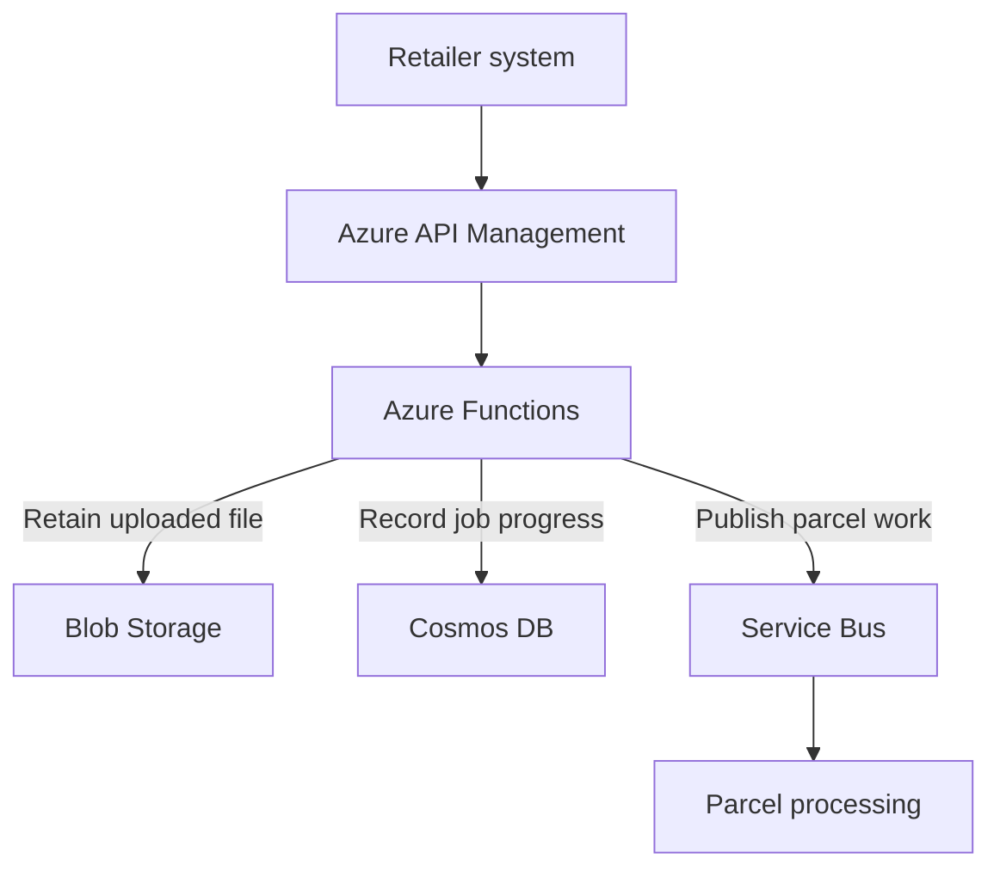

# Snowwave Platform

**Olalekan Ibrahim · Toronto, Canada · Solutions, cloud and integration engineering**

**Business → Operations → Engineering → Architecture**

A retailer uploads a parcel manifest. The upload succeeds, but a row fails downstream. What should the operations team tell the retailer? I built Snowwave, a non-production Azure platform for last-mile operations, to explore questions like this one. A useful answer has to distinguish receiving a file, processing its contents and confirming the business outcome.

My starting point was operational. Managing purchasing and inventory in my family’s agricultural business in Nigeria taught me how one team’s incomplete information becomes another team’s problem. Studying International Business Management at Niagara College Toronto and working in parcel sorting, scanning and loading in Toronto gave me a way to frame the engineering question. Which decision does someone need to make, and what evidence would let them make it?

## From a business problem to an engineering decision

| Question from operations | Engineering decision | Evidence to inspect |
|---|---|---|
| Which rows still need attention after an upload? | Track the job durably, validate rows and retry interrupted work. | [Runnable ingestion case](docs/case-studies/durable-manifest-ingestion.md) |
| Can an operator call a parcel recovered after requesting a replay? | Keep the case open until downstream processing confirms success. | [Recovery case](docs/case-studies/recovery-truth.md) |
| Who can change a service commitment, and what if two people edit it? | Authorize the change, retain its revision and surface competing edits. | [Service commitment case](docs/case-studies/service-commitments.md) |
| Which build is actually answering requests? | Compare the running application’s build identity with the intended release. | [Deployment investigation](docs/case-studies/deployment-runtime-truth.md) |

## Core technology stack

- **Private platform.** The C# Azure Functions app targets .NET 8, and its backend tests run on .NET 9. The platform uses Azure API Management, Entra ID, Blob Storage, Cosmos DB and Service Bus, with React for the operator UI and Bicep and GitHub Actions for delivery.
- **Public ingestion slice.** The C# project and its nine xUnit tests target .NET 8. The tests run locally with test doubles.

## Architecture at a glance

The retailer ingestion path shows where an external request becomes asynchronous work and where an operator can find its progress.



| Responsibility | How Snowwave handles it |
|---|---|
| Integrate retailer systems | Azure API Management fronts the retailer API. Azure Functions handles requests. Entra ID identifies callers, and application authorization scopes what they can do. |
| Automate ingestion and recovery | Blob Storage retains the uploaded file. Cosmos DB records job progress. Function workers validate rows and publish work through Service Bus. Operators can inspect failures and request replay. |
| Support business decisions | Operators use a web application to review exceptions and manage service policies. Versioned policy data gives a service commitment a traceable meaning when settings change. |
| Operate the cloud environment | Managed identities and role-based access control govern resource access. Bicep describes infrastructure. GitHub Actions deploys to non-production, then checks the running build and selected workflows. |

The earlier ingestion work answered “can the system resume this job?” Later work asked “is this action authorized, and which commitment applies?” A newer private intake pilot implements and tests business validation. Its source defaults to disabled. The containing build was deployed to non-production. Live pilot settings and end-to-end pilot operation remain unverified. Snowwave serves no production customers.

## Run the public ingestion slice

This representative earlier implementation includes C# ingestion code, nine executable tests and a CI workflow. It gives a reviewer a small workflow to run locally. The current private architecture extends beyond it.

**Prerequisite:** .NET 8 SDK

```bash
# 1. Clone the repository
git clone https://github.com/lekanibrak-cloud/snowwave-platform.git
cd snowwave-platform

# 2. Restore and build the public slice
dotnet restore tests/Snowwave.ManifestIngestion.Tests/Snowwave.ManifestIngestion.Tests.csproj
dotnet build tests/Snowwave.ManifestIngestion.Tests/Snowwave.ManifestIngestion.Tests.csproj --configuration Release --no-restore

# 3. Run the executable verification
dotnet test tests/Snowwave.ManifestIngestion.Tests/Snowwave.ManifestIngestion.Tests.csproj --configuration Release --no-build
```

Expected result:

```text
Passed! - Failed: 0, Passed: 9, Skipped: 0, Total: 9
```

The tests exercise the slice with test doubles, including a worker losing a concurrent update and a transient publish failure scheduling a retry. [Source provenance](docs/public-slice/SOURCE-PROVENANCE.md) · [Public CI](.github/workflows/verify-public-slice.yml)

## Verification snapshot · November 25, 2026

The private non-production release recorded **1,851 passed, 0 failed and 10 skipped** across the backend and web frontend. The public nine are a separate suite. The evidence index breaks out the release counts and a subsequent local-only backend result. [Technical evidence index](docs/evidence/TECHNICAL-EVIDENCE-INDEX.md)

## Transferable engineering

Logistics is Snowwave’s domain. The same questions arise when an order moves from a sales system to a fulfilment partner. What did the partner accept? Who can correct it? How will an operator know that a retry succeeded? These questions guide how I design business-system integrations, automate workflows and verify cloud solutions.

## How I work

I use AI assistance to investigate questions, draft changes and review evidence. I set the business objective, decide what behavior is acceptable and retain authority over release decisions. For example, passing the release checks gave me evidence that the expected build was serving. It left the newer pilot’s operational acceptance open.

That is the work I want to do in Solutions Engineering, Cloud Engineering, Integration Engineering and Solutions Architecture roles — discover what an operator or partner needs to know, choose an appropriate system boundary, and verify that the implementation supports the decision.

[Follow a parcel](docs/story/life-of-a-parcel.md) · [Engineering timeline](docs/evidence/EVOLUTION-TIMELINE.md) · [Architecture and research provenance](docs/evidence/ARCHITECTURE-SOURCE-PROVENANCE.md)
